<p align="center">
  
</p>

<!-- STATS:START -->
<p align="center">
  
  
</p>
<!-- STATS:END -->

<p align="center"><sub>
Sanitized case studies from offensive security labs and CTFs. Each file documents <b>architecture, protocol behavior and mitigations</b>,
never flags, credentials, target addresses or copy-paste exploitation steps.
</sub></p>

---

### `$ ls -t case-files/`

<!-- INDEX:START -->
| # | Case | Category | Difficulty | Tags | Link |
|:-:|:-----|:--------:|:----------:|:-----|:----:|
| `01` | **Autopilot**<br><sub>Protocol Breakdown & Hybrid Cross-Relay Analysis</sub> |  |  | `active-directory` `linux` `ntlm-relay` `webdav` | [`↗ read`](./machines/autopilot.md) |
<!-- INDEX:END -->

<sub>This table, the category pages and <code>index.json</code> are rebuilt automatically by GitHub Actions; don't edit them by hand.</sub>

---

### `$ tree -L 1`

```text
writeups/
├── machines/    full-chain lab machines (AD · Linux · hybrid)
├── web/         web application challenges
├── pwn/         binary exploitation
├── crypto/      cryptography
├── rev/         reverse engineering
├── forensics/   forensics & incident artifacts
├── misc/        everything else
├── TEMPLATE.md  skeleton for new case files
└── scripts/     index generator (run by CI)
```

### `$ cat HOWTO`

1. Copy [`TEMPLATE.md`](./TEMPLATE.md) into the right folder as `case-name.md`.
2. Fill in the header block (`title`, `subtitle`, `difficulty`, `tags`, `date`) and write the case.
3. Commit. The index, badges and category pages update themselves.

<p align="center"><sub><code>// read the architecture, not the answer key</code></sub></p>
